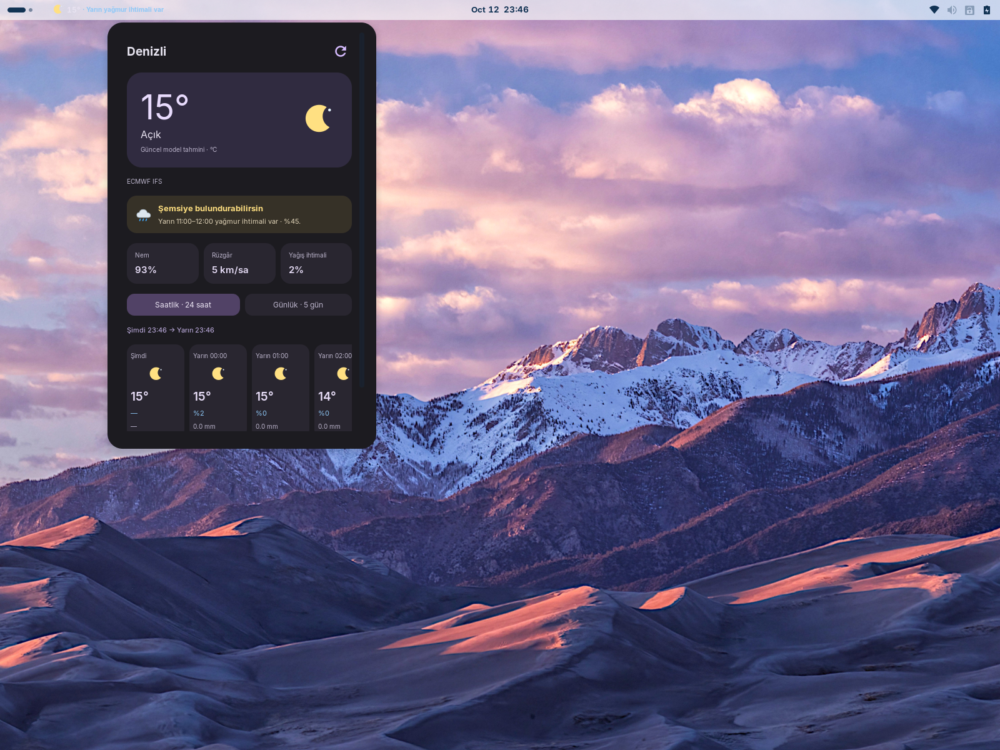
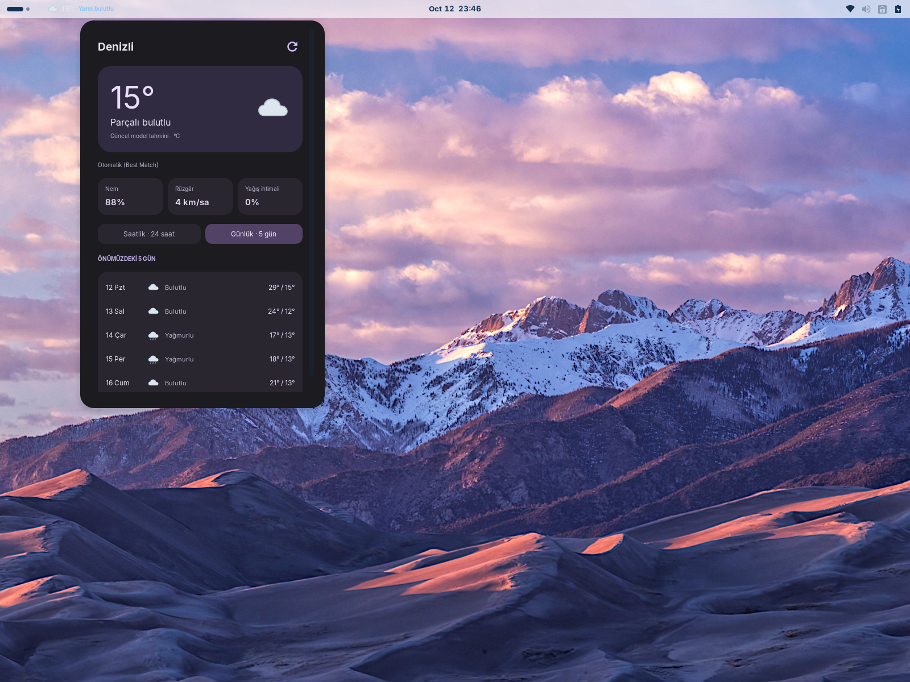
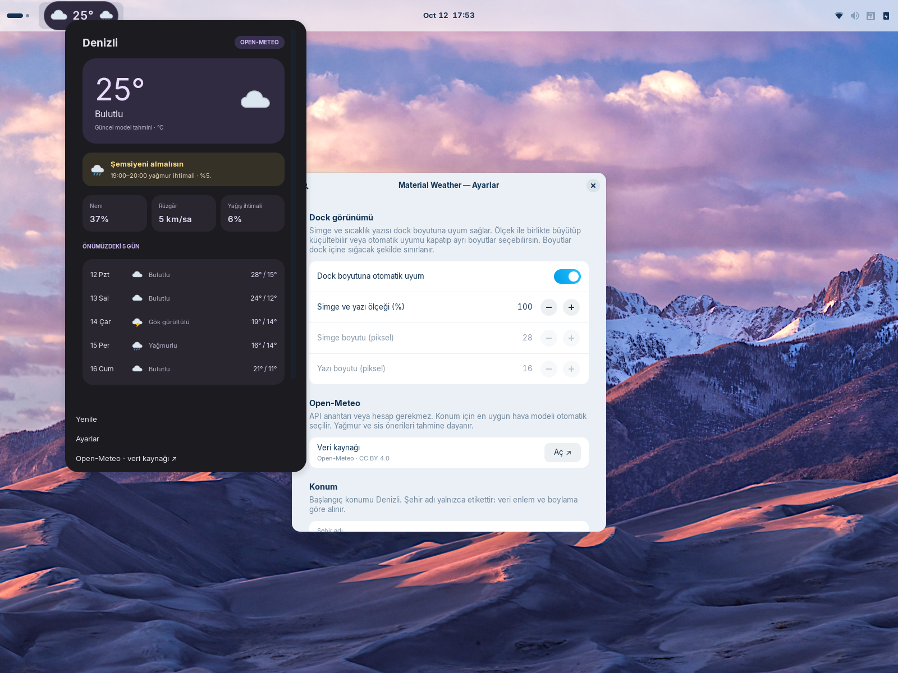

# Material Weather

GNOME Shell 46 için, girdiğin koordinatlara göre hava durumunu gösteren bir eklenti. Denizli yalnızca varsayılan konumdur; ayarlardan enlem ve boylam değiştirerek başka konumların tahminlerini görüntüleyebilirsin. Gösterge panelin **sol tarafında kendi ayrı, arka plansız ve kenar çizgisiz düğmesiyle** çalışır; sağ sistem kutusuna eklenmez. Güneş sarı, bulut gri, yağmur mavi damlalı SVG simgeleriyle gösterilir. Panel, ana kart ve beş günlük tahmin aynı renkli simgeleri kullanır; tema simgeleri tek renge çeviremez. Dockta yalnız güncel havanın simgesi bulunur. Günlük uyarı varsa yanında açık mavi “Bugün yağmur bekleniyor” gibi bir yazı görünür; ayrıntısı tıklayınca açılır. Yazı boyutu da dock ölçeğine uyum sağlar.

## Ekran görüntüleri

Bu görseller önceki geliştirme sürümlerinden alınmıştır; güncel sürümde saatlik ve günlük tahmin birlikte gösterilir, dil ve tema seçimi bulunur.



<details>
<summary>Günlük tahmin ve ayarlar</summary>





</details>

## Açık / koyu tema

**Sağ tık → Ayarlar → Tema → Görünüm:** “Sistemle aynı (otomatik)”, “Açık” veya “Koyu” seçilir. Varsayılan otomatik mod GNOME'un renk tercihini izler; tercih belirtilmediyse GTK temasının koyu olup olmadığına bakar. Sistem teması değişince görünüm anında güncellenir. Manuel seçim sistem tarafından değiştirilmez. Koyu görünümün mevcut renkleri korunur; açık görünüm açık yüzeyler ve okunaklı koyu yazılar kullanır. Şeffaf dock göstergesinin yazısı, panelin kendi kontrastına uyar. Uyarı yazısı daha koyu mavi gösterilir; siyah gölge veya kontur kullanılmaz. Açık zeminde bulutlar daha koyu gri ve kalın hatlı simgelerle gösterilir; koyu tema simgeleri korunur. Tema değişimi hava verisini yeniden indirmez.

## Canlı veri

**Ayarlar → Dock görünümü:** Simge ve sıcaklık yazısı dock yüksekliğine otomatik uyum sağlar. %50–150 ölçekle ikisini birlikte büyütüp küçültebilirsin. Otomatik uyumu kapatırsan simge (12–96 piksel) ve yazı (9–48 piksel) boyutlarını ayrı seçebilirsin. Seçimler anında uygulanır; dock içine sığan boyutla sınırlandırılır. Ekran ölçeklendirmesi hesaba katılır.

**API anahtarı veya hesap gerekmez.** Open-Meteo'nun anahtarsız Forecast API'si kullanılır. **Ayarlar → Open-Meteo → Tahmin kaynağı / model** bölümünden Otomatik (`best_match`), ECMWF IFS, DWD ICON veya NOAA GFS seçilir; API ve koordinatlar değişmez. Varsayılan seçim Otomatik'tir. Model değişince veriler hemen yeniden alınır. Sağlanmayan alanlar “—” gösterilir; eklenti tarafından başka bir modelin verileriyle doldurulmaz. Varsayılan konum Denizli (37.7765, 29.0864), yenileme aralığı 60 dakikadır. Güncel değerler model tahminidir; yerel sensör ölçümü değildir. Veriler: [Open-Meteo](https://open-meteo.com/), [dokümantasyon](https://open-meteo.com/en/docs), CC BY 4.0. Ücretsiz uç nokta kişisel/ticari olmayan kullanım içindir. Denizli için tahmin doğruluğunu ayrıca ölçmedik.

GNOME Eklentiler uygulamasındaki eklenti ayarları üzerinden şehir etiketi, koordinatlar ve yenileme aralığı değişir. Şehir etiketi koordinatları değiştirmez. Docktaki hava durumu göstergesine sağ tıklayınca “Ayarlar” menüsü açılır. Sol tıklama hava durumunu gösterir. Menünün sağ üstündeki döngü simgesi tahmini yeniler. Alt kısımda eylem veya site bağlantısı bulunmaz. Ağ hatasında son başarılı veri ve hata durumu gösterilir; örnek veriye geçilmez.

## Günlük öneriler

Konumun yerel saatine göre **21.00'den önce bugünün kalanı**, **21.00 ve sonrasında yarın** değerlendirilir. Geçmiş yağmur gösterilmez. Yağmur önerileri hedef günün 21.00 öncesindeki aralıkları için verilir; sis, kar, donan yağış ve fırtına hedef günün tamamında değerlendirilir.

- **Yağmur:** En az 0,1 mm yağmur/sağanak veya kar olmayan bir aralıkta en az %50 yağış olasılığı öneri üretir. Olasılık %50'nin altındaysa “Yağmur ihtimali var / Şemsiye bulundurabilirsin” yazılır; güçlü sinyalde “Yağmur bekleniyor / Şemsiyeni almalısın” yazılır. Olasılık bulunmuyorsa yağmurlu hava kodu ile miktar birlikte değerlendirilir.
- **Sis:** Sis kodu veya 1 km'den düşük görüş için uyarı verilir. Düşük görüş her zaman sis diye adlandırılmaz.
- **Fırtına / kuvvetli rüzgâr:** Gök gürültüsü kodları, en az 50 km/sa rüzgâr veya en az 60 km/sa hamleler için.
- **Kar / buzlanma:** Kar veya donan yağış kodları için.
- **Sakin hava:** Uyarı yoksa “Hava iyi görünüyor · Açık”, “Bugün parçalı bulutlu”, “Yarın bulutlu” gibi genel durum yazılır. Eksik veya üç saatten eski tahminle olumlu hava mesajı üretilmez.

Öneriler her dakika ve menü açıldığında yeniden hesaplanır. Bunlar resmi meteorolojik alarm değil, tahmine dayalı önerilerdir. Yağış miktarı ve olasılığı farklı hesaplamalardan gelebilir; düşük olasılıkta kesin yağmur ifadesi kullanılmaz.

## Saatlik ve günlük görünüm

Genişletilmiş panelde saatlik tahmin ve onun altında beş günlük tahmin birlikte görünür. Saatlik şerit, şu andan sonraki 24 saat içindeki gerçek saatlik model noktalarını gösterir; “Şimdi” kartı bulunmaz. Örneğin saat 14.00'te yarın 14.00 dahil, saat 14.30'da ise 15.00'ten yarın 14.00'e kadar olan saatlik noktalar gösterilir; aradaki dakikalar için veri uydurulmaz.

Saatlik görünüm tek bir kompakt şerittir. Fare tekerleği veya touchpad ile hızlanıp yavaşlayan 320 ms geçişle yatay kaydırılır; sol tıkla tutup sürükleyerek de gezilebilir. Odaklandığında sağ/sol yön tuşları çalışır. Alt kaydırma çubuğu gösterilmez. Saatlik şeridin dışında tekerlek paneli dikey kaydırır. Konum, periyodik görünüm güncellemelerinde korunur.

Her saat için gündüz/gece simgesi, sıcaklık, yağış olasılığı ve toplam yağış miktarı bulunur. Yağış miktarı ve olasılığı yazan saate kadar olan **önceki bir saatlik aralığı** anlatır. Beş günlük bölüm genel durumu ve en yüksek/en düşük sıcaklıkları gösterir. Panel genişliği 500 mantıksal pikseldir; yüksekliği ekranın kullanılabilir alanına uyarlanır.

## Kurulum / güncelleme

```bash
bash scripts/install.sh
```

Kod GNOME tarafından önbelleğe alındığı için güncellemeden sonra Shell'i yeniden yükle. X11: `Alt+F2` → `r` → Enter. Wayland: oturumu kapatıp aç. Gerekirse:

```bash
gnome-extensions enable material-weather@reisub.local
```

## Kontroller ve paket

```bash
npm test
bash scripts/package.sh
```

Paket: `dist/material-weather@reisub.local.shell-extension.zip`. Kontroller; geçmiş yağmur, yarının yağmuru, devam eden saatlik aralık, 21.00 sınırı, kar, olasılık eşiği, sis, eski veri, yerel tarih dönüşümü, 21.00 sonrası yarına geçiş, 24 saatlik pencere ve aynı API içinde model seçimini kapsar. Menü ve ayarlar ayrıca izole GNOME 46 oturumunda kontrol edilir.

## Çoklu dil desteği / Languages

İlk açılış dili, sistem dilinden bağımsız olarak **English**'tir. **Right click → Settings → Language** üzerinden English veya Türkçe seçilebilir. Seçim kaydedilir; dock, tahminler, uyarılar, tarihler ve açık ayarlar penceresi anında güncellenir. Dil değiştirmek hava durumu verisini yeniden indirmez.

Çeviriler `locales/` klasöründeki JavaScript dosyalarıdır. `locales/en.js` ana katalogdur; `i18n.js` eksik çeviriler için İngilizceye döner. Yeni dil eklemek için:

1. `locales/en.js` dosyasını yeni dil koduyla kopyala; örneğin `locales/de.js`.
2. **Anahtarları değiştirmeden** sağ taraftaki metinleri çevir. `{day}`, `{time}`, `{value}` gibi yer tutucuların adlarını koru; cümlede sıralarını değiştirebilirsin. Marka/model adlarını ve birimleri gerektiği dışında değiştirme.
3. `locales/index.js` dosyasına import ve bir kayıt ekle:

   ```js
   import de from './de.js';

   // languages dizisinin içine:
   {id: 'de', name: 'Deutsch', locale: 'de-DE', messages: de},
   ```

   `id` benzersiz olmalı; `name` dilin kendi dilindeki adı, `locale` geçerli bir Intl/BCP 47 yerel ayar kodu olmalı. Kayıt eklenince dil seçicide otomatik görünür. Şema, kurulum veya paketleme betiklerini değiştirmek gerekmez.

4. `npm test` ve `bash scripts/package.sh` çalıştır. Testler eksik/fazla anahtarları, boş çevirileri ve yer tutucu uyuşmazlıklarını denetler. Çalışırken eksik alanlar İngilizceye dönse de katkı olarak gönderilen bir dilin kataloğu tam olmalıdır.
5. `bash scripts/install.sh` ile kur; GNOME kod önbelleği için Shell'i yeniden yükle. Yeni dili seçip uzun metinleri, uyarıları, sağ tık menüsünü ve açık/koyu görünümü kontrol et. Sağdan sola yazılan bir dil ekliyorsan metin yönü ve yerleşimi ayrıca doğrula.

Yeni bir arayüz metni ekleyen kod değişiklikleri, önce `locales/en.js` ve `locales/tr.js` içine aynı anlamsal anahtarı eklemeli ve kodda `t('anahtar', {değerler})` kullanmalıdır. Cümleleri parça parça birleştirmek yerine yer tutuculu tam mesajlar kullan. Kullanıcının şehir adı ve koordinatları çevrilmez.

## Pull request kuralları

- Her PR tek bir amacı kapsamalı. Yeni dil, arayüz değişikliği ve veri/uyarı mantığı değişikliklerini mümkünse ayrı gönder.
- Başlık ve açıklama somut olmalı: hangi sorun çözülüyor, kullanıcıya görünen sonuç ne, nasıl doğrulandı? Tamamlanmamış işleri ve yapılamayan kontrolleri açıkça yaz.
- `npm test` ve `bash scripts/package.sh` geçmeli. İşlevsel değişikliklerde ilgili davranışı doğrulayan test ekle; yalnız renk/boşluk değişiklikleri için gereksiz test yazma.
- Yeni dil PR'ında dil kodunu, ana dili konuşan biri tarafından kontrol edilip edilmediğini ve dilin seçildiği bir ekran görüntüsünü belirt. Bütün anahtarlar ve yer tutucular ana katalogla eşleşmeli.
- Arayüz değişikliklerinde İngilizce/Türkçe ve açık/koyu görünümü kontrol et. Uzun metinlerde taşma, klavye erişimi, dock ölçeklendirmesi ve ilgiliyse tekerlek/sürükleme davranışını incele; ilgili ekran görüntülerini ekle.
- Veri kaynağı, eşikler veya zaman aralığı değişiyorsa kullanılan alanları ve zaman dilimi varsayımlarını açıkla. API anahtarı gerektirmeyen kullanım korunmalı; düşük olasılıklı tahminler kesinmiş gibi sunulmamalı.
- API anahtarı, parola, kişisel ayarlar, günlükler, `dist/`, `.preview/` veya yerel test oturumu dosyalarını PR'a ekleme. Kaynak dosyaları ve gereken belgelerle sınırlı kal.
- PR, proje sahibinin inceleme ve onayından sonra birleştirilir. Bir PR gönderilmiş olması yayımlama veya otomatik birleştirme izni değildir.

PR açıklaması için `.github/pull_request_template.md` şablonu kullanılabilir.

## Lisans ve katkılar

Kaynak kod ve eklentiyle gelen SVG simgeleri **GPL-2.0-or-later** lisanslıdır; tam metin [LICENSE](LICENSE) dosyasındadır. Hava durumu verileri Open-Meteo tarafından CC BY 4.0 altında sağlanır; bu veri lisansı kod lisansından ayrıdır. Ekran görüntülerindeki masaüstü duvar kâğıtları bu kod lisansının kapsamına alınmaz.

Katkı özeti: [CONTRIBUTING.md](CONTRIBUTING.md). Yeni diller ve PR kuralları yukarıdaki bölümlerde açıklanmıştır.

## GNOME Extensions’da yayımlama

[Gönderim rehberi](docs/GNOME_SUBMISSION.md), depo URL’sini eklemeyi, gönderim öncesi kontrolleri, ZIP oluşturmayı ve siteye yüklemeyi adım adım anlatır.

```bash
npm test
bash scripts/package.sh --ego
```

Gönderilecek dosya: `dist/material-weather@reisub.local.ego.shell-extension.zip`. Gerçek depo adresini `metadata.json` içindeki `url` alanına eklemeden GNOME paketi oluşturulmaz. Desteklenen sürüm şu an GNOME Shell 46’dır.
